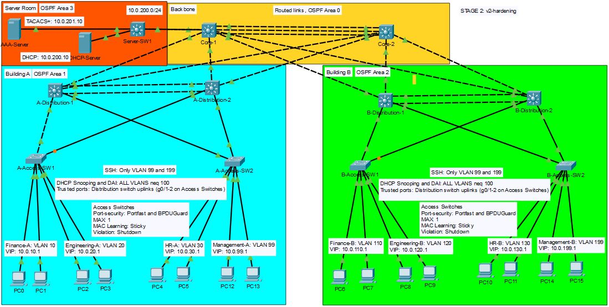

## Lab 2 TNARC Financial HQ: Access Hardening

Builds on [Lab 1: Three-Tier Campus](https://github.com/gusRod36/TNARC_HQ_Lab_01)

## The Problem

Before TNARC expands to new branches, an internal security review audits the HQ network. As a financial company, TNARC handles sensitive client data, so the review declared the findings unacceptable. Leadership wants every finding closed before any new site goes live.

## Audit Findings

| ID | Finding | Risk | Severity |
|----|---------|------|----------|
| F1 | Devices are managed over Telnet | Credentials are sent in clear text. Anyone capturing traffic on a user VLAN could obtain admin credentials and take control of the network. | High |
| F2 | Admins share one local password | Changes can't be traced to a person, which breaks accountability and audit trails. A departing employee keeps access until the shared password is changed everywhere. | High |
| F3 | No protection against rogue DHCP servers on user ports | A rogue server could hand clients a malicious gateway or DNS server, routing finance traffic through an attacker, or cause outages by handing out bad addresses. | High |
| F4 | No protection against ARP spoofing on user VLANs | An attacker on the same VLAN could impersonate the default gateway and intercept or alter other users' traffic, including sessions to internal finance systems. | High |
| F5 | Any device can connect into any user port | Unapproved personal or attacker devices can join internal VLANs with full access to department networks and services. | Medium |
| F6 | User ports don't block spanning-tree BPDUs | A switch connected to a user port could take part in spanning-tree, possibly becoming root bridge. That could cause network-wide disruption or redirect traffic through an unauthorized device. | Medium |
| F7 | Device management is reachable from every user VLAN | Any user, or any compromised workstation, can attempt to log in to network devices. That widens the attack surface for bruteforce attacks and other exploits. | Medium |
| F8 | Passwords are stored in plain text or with reversible encryption | Anyone who sees the configuration file (a backup, a support ticket, a repository) can read device passwords directly. | Medium |
| F9 | No idle session timeout or login attempt limits | Unattended admin sessions stay open for anyone to use, and unlimited login attempts allow bruteforce attacks. | Low |
| F10 | No warning banner before login | Without notice that access is restricted and monitored, enforcing policy or taking action against misuse becomes difficult. | Low |

## Controls Applied

| ID | Control | Applied to | Evidence |
|----|---------|------------|----------|
| F1 | SSH v2 enabled with RSA keys. Telnet disabled on all VTY lines. | All Switches | [F1](./Verification/evidence.md)  |
| F2 | Central authentication through AAA-Server (TACACS+) with individual admin accounts. One local emergency account as fallback if the server is unreachable | All switches | [F2](./Verification/evidence.md) |
| F3 | DHCP ssnooping all user vlans, uplinks to distribution switches trusted, user ports untrusted | Access Switches | [F3](./Verification/evidence.md) |
| F4 | Dynamic ARP inspection on all user VLANs, validated against DHCP snooping bindings; uplinks trusted | Access switches | [F4](./Verification/evidence.md) |
| F5 | Port security on user ports: 1 MAC per port, sticky learning, shutdown on violation | Access switch user ports | [F5](./Verification/evidence.md) |
| F6 | PortFast with BPDU Guard on all user ports; a switch connected to a user port is err-disabled | Access switch user ports | [F6](./Verification/evidence.md) |
| F7 | VTY access restricted to the management VLANs (10.0.99.0/24, 10.0.199.0/24) | All switches | [F7](./Verification/evidence.md) |
| F8 | enable secret replaces enable password, local accounts use secret. service password-encryption enabled as an extra measure. | All Switches | [F8](./Verification/evidence.md)|
| F9 | Idle timeout on console and VTY lines; login attempts limited on SSH | All switches | [F9](./Verification/evidence.md) |
| F10 | Login banner stating that access is restricted and monitored | All switches | [F10](./Verification/evidence.md) |

## Topology Changes
| Device | Service | Subnet | Change |
|--------|---------|--------|--------|
| AAA-Server | TACACS+ | 10.0.201.0/24 | Added |

## Key Decisions
1. Which ports does DHCP snooping trust, and why those?
    - The uplink ports going to the Distribution routers are trusted. Trusted uplinks ensure that only legitimately authorized DHCP server send DHCP messages, verifying that clients recieve valid IP addresses from the correct DHCP server.

2. Port security: how many MACs per port, sticky or static, and which violation mode?
    - Maximum MACs per port 1, Sticky learning, and shutdown violation mode.

3. TACACS+ or RADIUS for device logins, and why?
    - TACACS+ encrypts the entire message instead of just the password. It also handles logins, permissions, and logging as separate steps allowing control over the commands each admin can use. TACACS+ uses TCP instead of UDP, ensuring reliable connections.

4. What happens to admin access if the AAA server is unreachable?
    - There is a local admin login to fall back on in emergency scenarios. 

5. Who is allowed to SSH to network devices, and how is that enforced?
    - Management VLAN 99 and 199, ACL denying all connections to SSH except for those in the 10.0.99.0/24 in Building A or 10.0.199.0/24 in Building B.

6. Why does dynamic ARP inspection depend on DHCP snooping? What about devices with static IPs?
    - DAI uses the DHCP snooping binding table to reliably compare the relationship between IP to MAC address. Without the snooping binding table, DAI would drop all packets. 
    - For static IPs there are a few work arounds: 1. ARP ACL, create a list of allowed IP to MAC pairs (statics) and use "ip arp inspection filter <acl> vlan <id>". 2. Give the device a fixed address that is reserved on the server. 3. Leave static IPs in a VLAN without DAI. This lab has all vlans and hosts on DHCP addresses so these conditions do not affect my hosts, but if they did these would be the options.

## Challenges and Fixes
1. Access switches were not able to receive ping responses beyond the distribution switches.
    - A default gateway needed to be configured globally for the SVIs subnet. The default gateway does not affect traffic from the other VLANs.
    - Layer 2 switch SVIs are in Protocol:DOWN by default since no physical ports are connected, a "no shutdown" command needs to be issued to start up the SVI.
    - REMINDER: Add the SVI's VLAN to allowed in the trunk port, add the subnet to OSPF on both distribution switches for failover, and test connectivity to the AAA server BEFORE configuring login to avoid being locked out.

2. (Informational) I decided to disable DHCP snooping information option for this Lab because the Access switches are not acting as relay agents so the default gateways in the request would be empty. when the request reaches the distribution switches the request would be dropped by default.

## Lab Credentials
| Level | Username | Password |
|-------|----------|----------|
| tacacs+ | test | test123 |
| tacacs+ | TNARCadmin01 | admin123 |
| enable | CiscoTNARCtest | |
| local | localadmin | localpass |

## Limitations
1. Cisco Packet Tracer does not support "login block-for" nor "login quiet-mode access-class" which would better support the login limitations on the VTY and Console lines.

2. Port Security trusts MAC addresses, which can be spoofed. 802.1X port authentication would close the gap but is not within the scope of the lab.

## What I'd Do Next
1. Add Web, DNS, NTP and Firewall services across the network.
2. Multi-site WAN with dynamic routing for any branches that need connection to HQ.
3. NOC and Network Management.
4. Enterprise Wireless.