## F1: Telnet vs SSH

#### Before

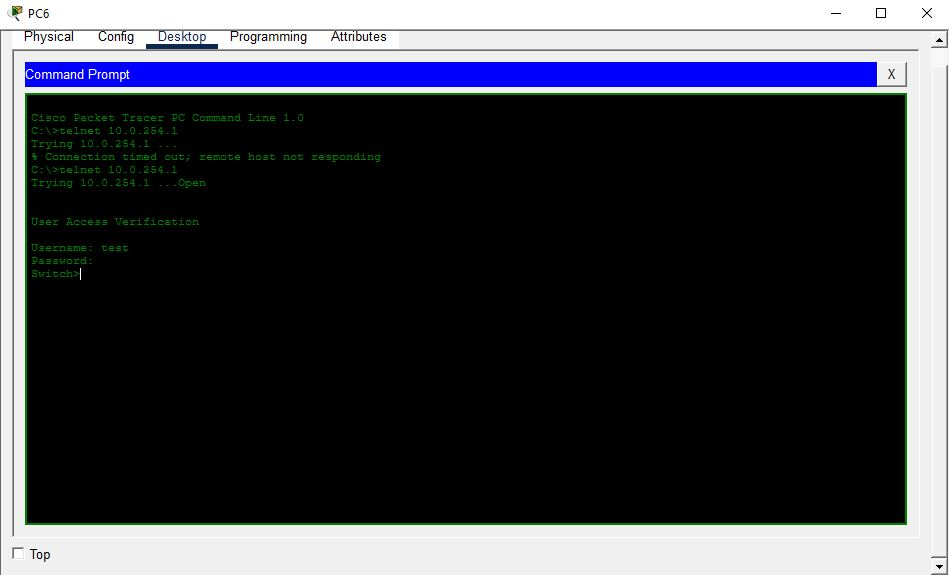
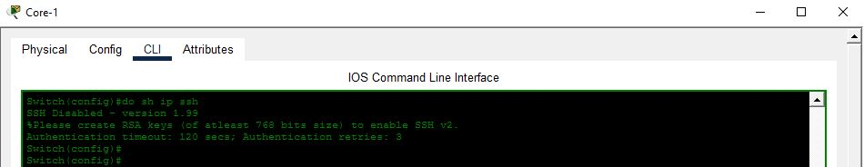
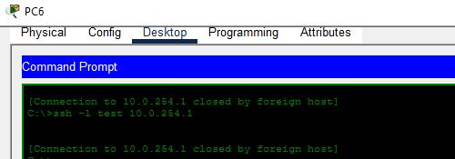

#### After

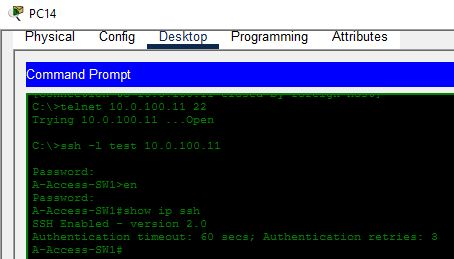

## F2: AAA login, plus local fall back

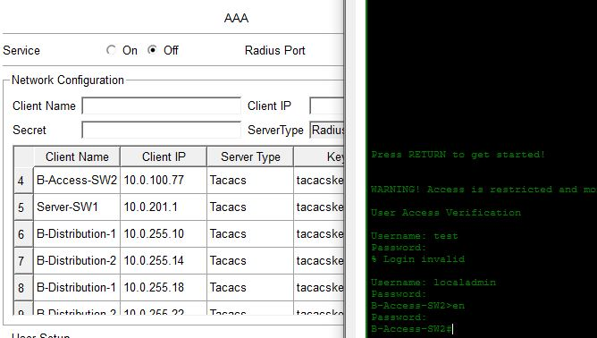

## F3: Rogue DHCP

#### Before

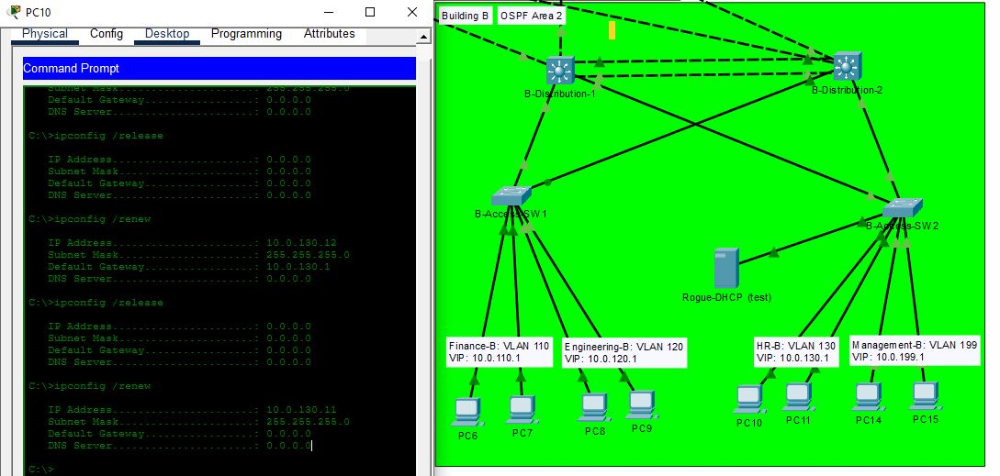

Here we can see the PC was being handed a broken default gateway by the Rogue DHCP server

#### After

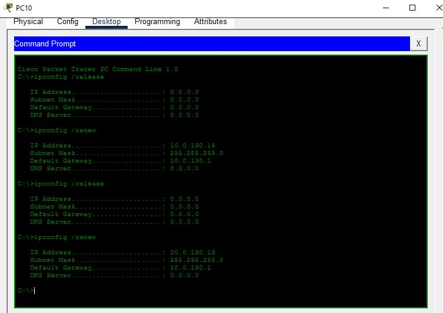

No matter how many attempts were tried the correct server always handed out the DHCP messages.

## F4: ARP-Inspection

#### Before

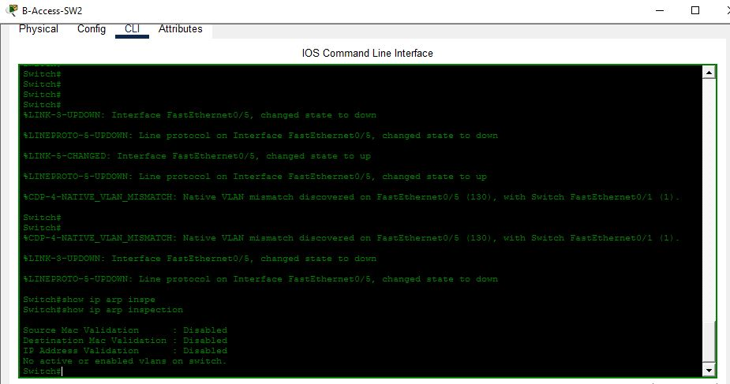

#### After 

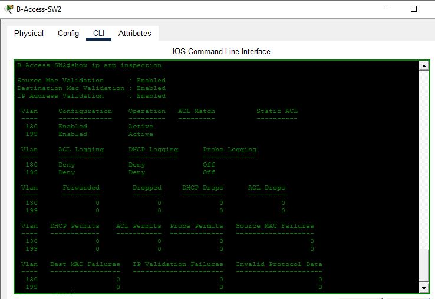

## F5: Port-Security

#### Before

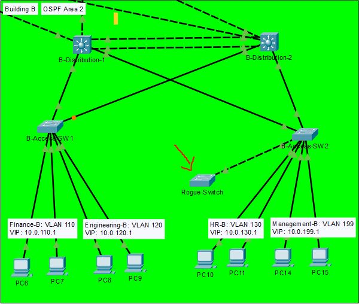

#### After

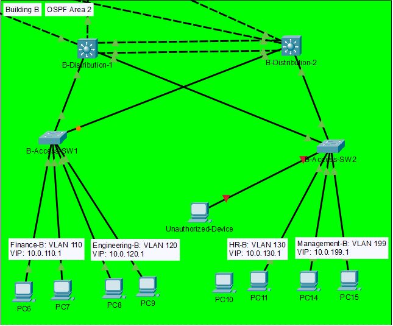

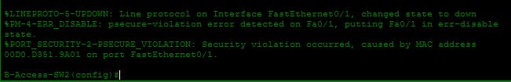

here we have a rogue switch and an Unknown device being blocked by psecure.

## F6: Rogue Switch

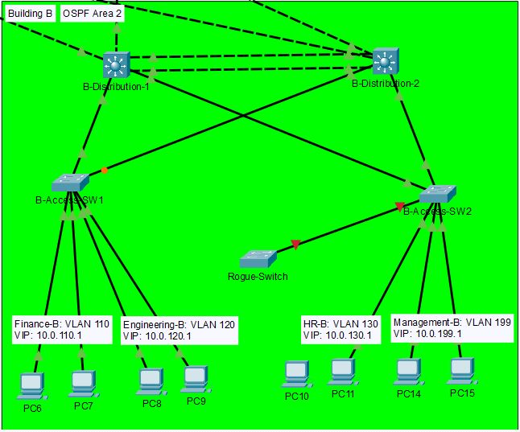
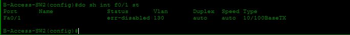

## F7: Management Access Restricted

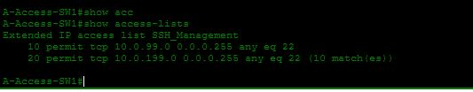

## F8: Password Encryption

#### Before

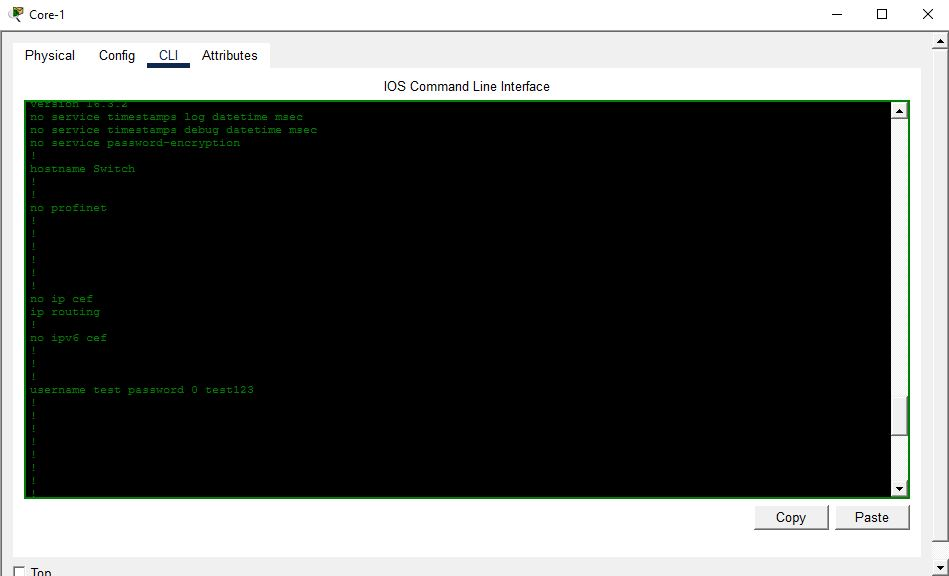

#### After

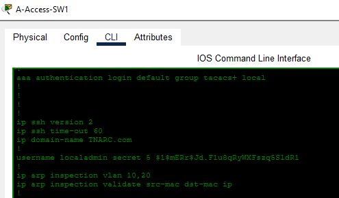

## F9: Session limits

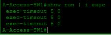

## F10: Banner

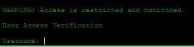